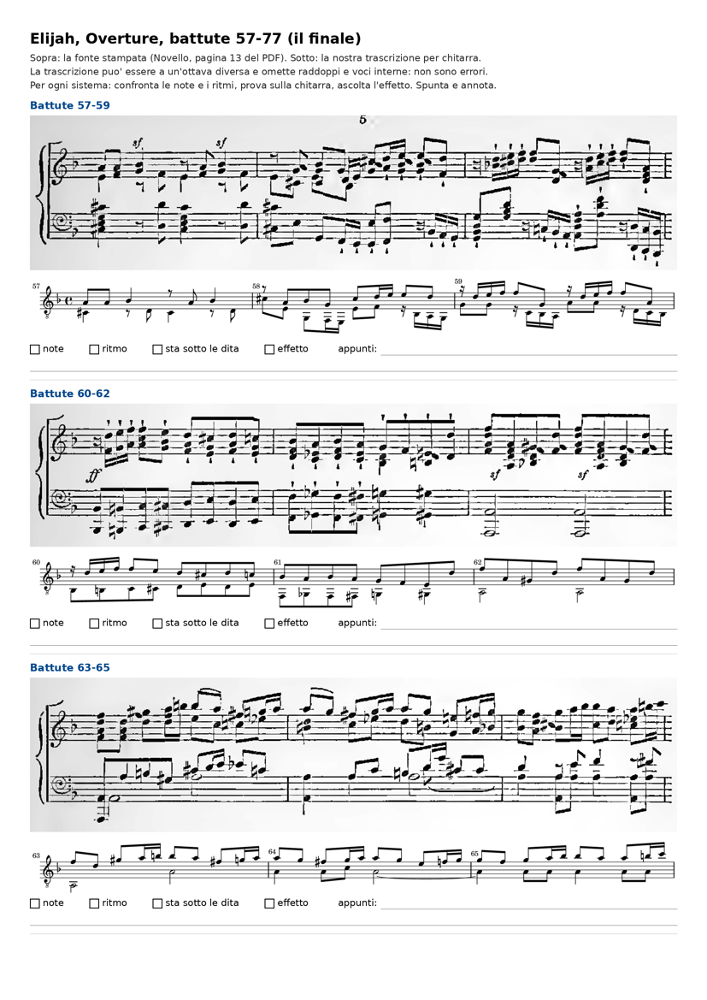
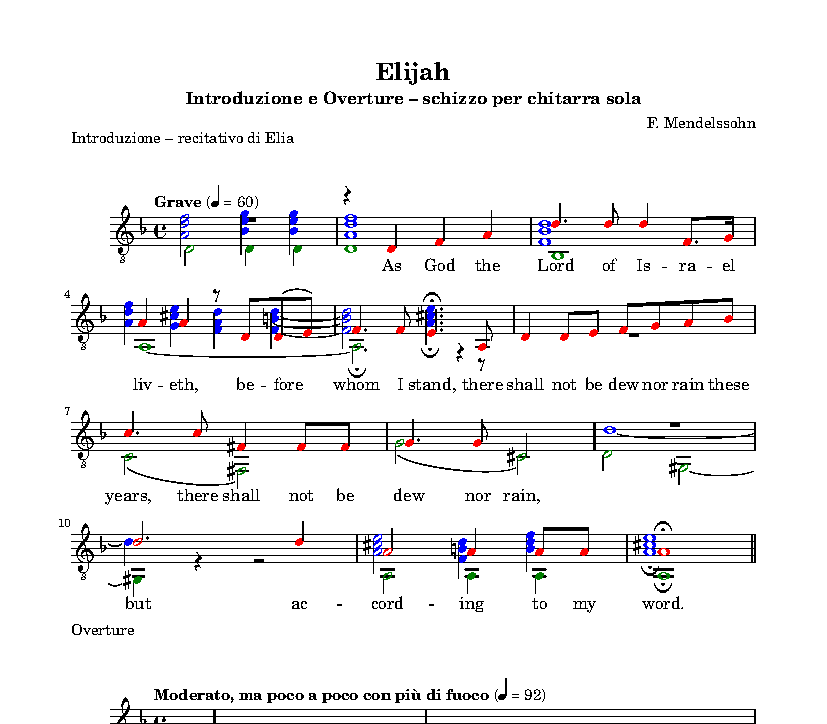

[Italiano](README.md) · **English**

<!-- Traduzione di README.md. L'italiano fa fede: questo file non si modifica
     a mano, si rigenera dall'originale. Tradotto dalla versione del 2026-11-27. -->

# Classical guitar transcriptions with LilyPond and an AI assistant

> This is a translation. The [Italian README](README.md) is the reference
> text and is updated first; the work log and the PDF table live only there.

**Welcome to anyone who wants to contribute**: guitarists who try a page and
say what does not work, people who can read a source better than we do, people
who know LilyPond. See [How to contribute](#how-to-contribute).

> **State of the work: everything still to be verified.** So far there has
> been no time to check the AI-made transcriptions on the instrument and
> against the sources, nor to transcribe the whole of maestro M. Vercesi's
> original manuscript (only some parts are engraved). The scores below are
> therefore **working drafts**, not editions to study from or perform.

## Why this repository

Music engraving is dominated by proprietary programs, often at a prohibitive
price and with no real alternative. The manuscript remains the best option,
but many people also want an engraved version, and engraving is a hard art to
master. [LilyPond](https://lilypond.org) is a valid, free alternative: the
result is beautiful, but the language is convoluted and slow to learn. Here an
AI helps us write it; **its work still has to be checked**, note by note,
against the source and on the instrument.

The good part is that with git and LilyPond everything is text: every choice
can be tracked, dropped and picked up again, by others too, as in open source
software.

## Acknowledgement

None of this would have been possible without **maestro M. Vercesi**, who
with great patience guided the transcription and shared the method, the
technique, the choices, the good taste, the respect for how voices behave, and
the compromises the guitar itself imposes.

## Latest work

The dated work log, newest first, is kept in Italian:
[Ultimi lavori](README.md#ultimi-lavori). Every step of work adds an entry
there: what changed, why, and what remains unverified.

## The scores, to download

The table of all PDFs produced so far, newest first, is in the Italian README:
[Le partiture, da scaricare](README.md#le-partiture-da-scaricare). The files
are in [`pdf/`](pdf/). They are **working drafts**, not editions: read
[the state of each piece](#pieces-in-progress) before trusting a note.

### How to rebuild them

You need [LilyPond](https://lilypond.org) 2.24 and `make`.

    make                               # every edition, in build/<piece>/
    make BRANO=mendelssohn-elijah      # one piece
    make build/smetana-moldava/moldava.pdf    # one edition
    make pubblica                      # rebuild, copy to pdf/ and update the table

### Which files to edit

Each piece is a folder `brani/<piece>/`, split into independent layers:

| I want to change… | File to edit |
|---|---|
| a note, a rhythm, a rest | `brani/<piece>/music/*.ly`: one variable per voice, one bar per line, preceded by its number (`%12`) and closed by a bar check |
| a fingering, a string, a barré | `brani/<piece>/dita/*.ly`: same rhythm as the notes, written with spacers (`s4-3` = finger 3 on the note of that quarter) |
| a chord symbol, a degree, a function | `brani/<piece>/armonia/*.ly` |
| which voices are on the staff, colours, dynamics | `brani/<piece>/layers/*.ly` |
| page format, density | `impaginazioni/*.ly` (shared by all pieces) |
| what a PDF prints (layout + options) | `brani/<piece>/editions/<name>.ly`: a few lines; copy one to make a new edition |
| a shared function or option | `lib/*.ly` (options are listed in `lib/opzioni.ly`) |

Note names are Italian (`do re mi`, `dod` = C sharp, `sib` = B flat; `'` and
`,` move the octave). After every change run `make`: if a bar does not add up,
LilyPond gives the line. File names, variable names and comments in the
sources are in Italian. Details in [brani/README.md](brani/README.md).

### How to contribute

- **Play and report.** The most useful contribution: open a PDF, try a
  passage, and write in an *issue* the bar and what is wrong (wrong note, does
  not lie under the fingers, does not give the effect). No LilyPond needed.
  English is fine.
- **Review with the sheet.** In [docs/revisione/](docs/revisione/) there are
  sheets with the source above and the transcription below: print, tick,
  photograph.
- **Fix the sources.** One bar per line: a *pull request* with the corrected
  line and the source it comes from is welcome.
- **Propose another solution.** Fingerings and reduction choices are separate
  layers: you can add yours without deleting what is there.
- **Propose a piece** in the public domain, with its source.

**Three rules for every contribution**, by a person or by an AI assistant:

1. **Update [Ultimi lavori](README.md#ultimi-lavori)** at the top of the
   Italian README with a dated entry: what you changed, why, and what you did
   not verify. That entry alone must be enough to understand the latest work.
2. Say whether each note is *read* (from which source), *deduced* or
   *unverified*.
3. Use only public-domain sources or sources with a compatible licence, and
   cite them.

---

A workshop: reducing for **solo guitar** music written for orchestra, choir or
ensemble (Handel, Mendelssohn, Vivaldi, Smetana), writing the scores in
LilyPond with the help of an AI assistant, and finding out **how much of this
work can really be entrusted to an AI** and how much has to be reread,
corrected and listened to by a guitarist.

## The process we follow

1. **Source.** We start from public-domain editions (IMSLP) or from the
   manuscript; the PDFs are in `brani/<piece>/fonti/`.
2. **Reading.** The AI reads the scan bar by bar, with a grid of note names
   overlaid on the staff, and writes the notes in LilyPond.
3. **Layers.** Notes, fingerings, harmony and layout are in separate files, so
   each choice can change without touching the others.
4. **Adversarial check.** A second reader, who has not seen the first one's
   work, compares the transcription with the print assuming it is wrong:
   rhythms first, then pitches. Where two editions exist they are
   cross-checked.
5. **Automatic check.** A script verifies that the bass stays below the melody
   and that the notes lie under the fingers.
6. **Human review.** A *review sheet* is printed (source above, transcription
   below), played, listened to, annotated. This is the step that decides.

## The three criteria (and where the AI really helps)

Every bar is judged three times, and they are three different judgements:

| Criterion | Question | What the AI can do | What is left to the guitarist |
|---|---|---|---|
| **Agreement** with the original | Are notes and rhythms those of the source? | Read, compare, have a second reader check. It works, but it makes mistakes: see below. | Decide the doubtful cases, above all where editions disagree. |
| **Idiomatic writing** | Does it lie under the fingers? Does it sound natural on the instrument? | Mechanical checks: range, hand stretch, voice crossings. | Everything else: fingering, position, effort, speed. Only playing tells. |
| **Effect** | Does it give the illusion of the original? | Suggest solutions (octaves, harmonics, arpeggios instead of held chords, per-voice dynamics). | Judge by ear, and have the courage to change the notes, as Villa-Lobos does, when the effect asks for it. |

### Doubts, stated

- **The AI misreads more often than it seems.** In the Elijah Overture the
  independent checks found 14 errors in bars already considered good:
  inverted rhythms, missing accidentals, a tied note that was restruck, wrong
  chords. Without the second reader they would have stayed.
- **The AI neither hears nor plays.** Everything about idiomatic writing and
  effect is written at the desk: plausible, never tried. Three errors were
  found by the guitarist's ear before the checks.
- **The AI states its uncertainties, but not always.** More than once a
  "deduced" reading turned out wrong. Rule adopted: every note is *read*,
  *deduced* or *unverified*, and which one must be written down.
- **Checking is expensive.** Checking takes more work than writing. It is
  still open whether, all told, time is saved compared with transcribing by
  hand, or whether the gain is something else: generating different versions,
  levels and study material from the same music.
- **How much freedom?** A note-for-note faithful reduction is often not
  guitaristic. Where transcription ends and new writing begins is a musical
  decision, not a technical one.

## Tempo, sacrifice and the fermata

Enjoying the notes of the guitar means playing, stopping, listening, and
contemplating every wave a sound sends out. On the classical guitar the
musical *fermata* is almost the default, and a must: a reduction that leaves
no time to listen does not work, however faithful.

Three choices follow, for every piece:

- **lower the tempo**, even a great deal. Above all for the first movement of
  RV 93 and for the Elijah Overture;
- **sacrifice notes**: not everything in the score fits under the fingers, and
  not everything is needed to make the orchestra heard;
- **look for an effect** that suggests what cannot be played, instead of
  piling up voices.

Paradoxically, the Concerto RV 93 is one of the hardest to render complete on
the guitar. It is not a matter of range: the voices tread on each other's
toes, even visually on the staff. The crux is dexterity, especially fast bass
notes with the thumb, very hard while the other fingers carry the rest. The
"all voices on one staff" version is there to see what exists, not to be
played as it stands.

## To do: learn from those who have done it before

The structure of these sources grew along the way. **It has not yet been
compared with the established practice** of people who have published with
LilyPond for years, and it must be, for two purposes: to make the sources more
maintainable, composable and layered, so that everyone can engrave the version
they want; and to give models examples and rules to learn the right patterns
from. Starting points (a list still to be verified and studied): the LilyPond
manuals, [openLilyLib](https://github.com/openlilylib) and its
*edition-engraver*, the sources published on
[Mutopia](https://www.mutopiaproject.org), and critical editions of
manuscripts.

## Pieces in progress

| Piece | State | Open |
|---|---|---|
| **Handel, Messiah, Overture** (`messiah-overture`), transcription by M. Vercesi | Grave in draft; Allegro bars 1–38 and the last 11 from the manuscript | Allegro bars 39–74 missing; comparison with the manuscript; maestro M. Vercesi's fingerings |
| **Handel, Messiah no. 2, "Comfort ye"** (`messiah-comfort-ye`) | Bars 1–13 | Bars 14–37 |
| **Mendelssohn, Elijah, Introduction and Overture** (`mendelssohn-elijah`) | Recitative complete; whole Overture, 77 bars; rhythms and pitches checked; inner voices in bars 21–38 and 57–77 | Inner voices in bars 39–56; second check of bars 57–77; bar 71 (G or G sharp: the editions disagree); never tried on the instrument |
| **Vivaldi, Concerto RV 93** (`vivaldi-rv93`) | First movement (51 bars) re-read from the autograph and checked by a second reader, all voices on one staff | Making it guitaristic (tempo, notes to sacrifice); Largo and third movement |
| **Smetana, Vltava** (`smetana-moldava`) | Experiment: 74 bars, the flutes of the introduction in one line, theme on the fourth string | Paused: the guitarist is reviewing the effect |

## Where to read the rest (in Italian)

- [IDEE.md](IDEE.md): ideas, work plan, open decisions.
- [docs/cronologia-chat.md](docs/cronologia-chat.md): the conversation with
  the assistant, to trace the choices.
- [brani/README.md](brani/README.md): how a piece folder is made.
- [LICENZE.md](LICENZE.md): what is covered by which licence.

## Credits and sources

The guitar transcription of the Messiah Overture is by **M. Vercesi**; this
repository engraves it with LilyPond from his manuscript. Handel's notes
(public domain) are compared with the piano reduction by T. Tertius Noble and
Max Spicker, G. Schirmer 1912 (IMSLP #11870), and with the orchestral score in
LilyPond by Éditions Nicolas Sceaux (<https://github.com/nsceaux/nenuvar>,
CC BY-SA 4.0), used for comparison only: none of its files is copied here.
