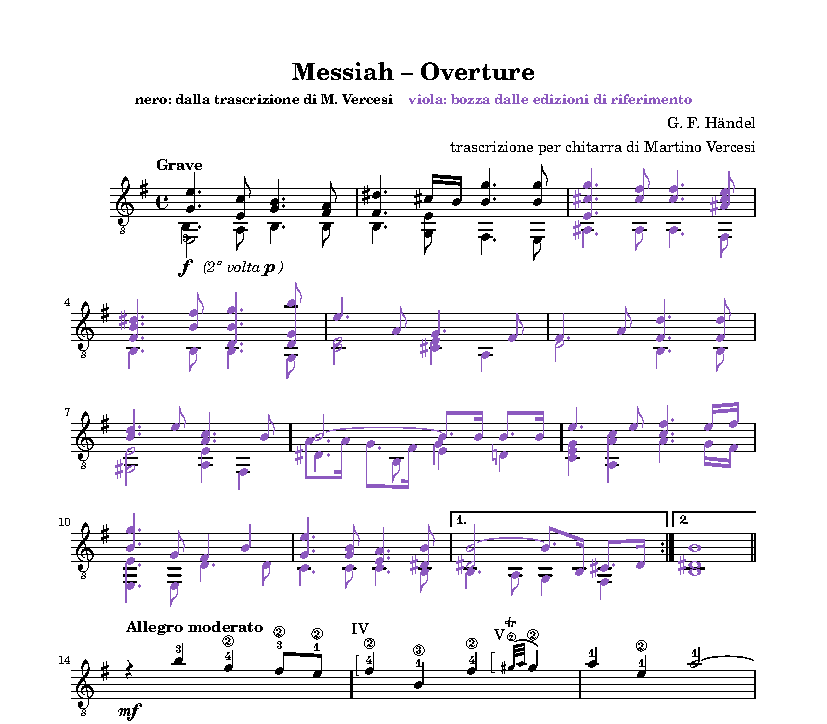
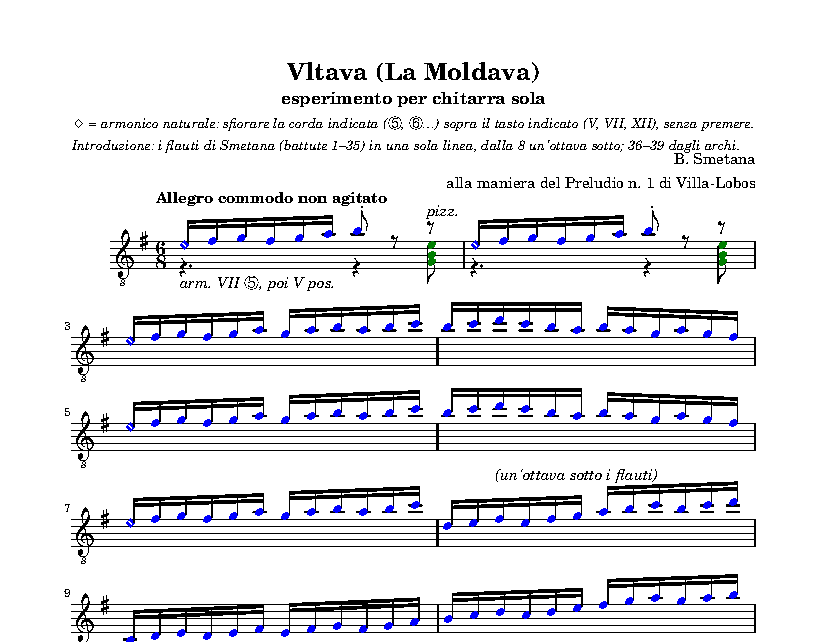

# Trascrizioni per chitarra classica con LilyPond e un assistente AI

Un laboratorio: ridurre per **chitarra sola** musica nata per orchestra, coro o
ensemble (Händel, Mendelssohn, Vivaldi, Smetana), scrivendo le partiture in
LilyPond con l'aiuto di un assistente AI, e capire **quanto di questo lavoro si
può davvero affidare all'AI** e quanto va riletto, corretto e ascoltato da un
chitarrista.

È un cantiere aperto. Quasi tutto quello che c'è qui è una **bozza da
verificare**, non un'edizione.

## Il processo che stiamo seguendo

1. **Fonte.** Si parte da edizioni di pubblico dominio (IMSLP) o dal manoscritto;
   i PDF stanno in `brani/<brano>/fonti/`.
2. **Lettura.** L'AI legge la scansione battuta per battuta, con una griglia dei
   nomi delle note sovrapposta al rigo, e scrive le note in LilyPond.
3. **Strati.** Note, diteggiature, armonia, impaginazione stanno in file
   separati, così ogni scelta si può cambiare senza toccare le altre.
4. **Verifica avversariale.** Un secondo lettore, che non ha visto il lavoro del
   primo, confronta la trascrizione con la stampa partendo dal presupposto che
   sia sbagliata: prima i ritmi, poi le altezze. Dove esistono due edizioni si
   incrociano.
5. **Controllo automatico.** Uno script verifica che il basso stia sotto il
   canto e che le note stiano sotto le dita.
6. **Revisione umana.** Si stampa una *scheda di revisione* (fonte sopra,
   trascrizione sotto), si suona, si ascolta, si annota. È il passo che decide.

La scheda si genera con `strumenti/scheda_revisione.py`; un esempio completo è
[docs/revisione/elijah-overture-57-77.pdf](docs/revisione/elijah-overture-57-77.pdf).

## I tre criteri (e dove l'AI aiuta davvero)

Ogni battuta va giudicata tre volte, e sono tre giudizi diversi:

| Criterio | Domanda | Che cosa può fare l'AI | Che cosa resta al chitarrista |
|---|---|---|---|
| **Concordanza** con l'originale | Le note e i ritmi sono quelli della fonte? | Leggere, confrontare, far controllare da un secondo lettore. Funziona, ma sbaglia: vedi sotto. | Decidere i casi dubbi, soprattutto dove le edizioni non coincidono. |
| **Idiomaticità** ("chitarrabilità") | Sta sotto le dita? Suona naturale sullo strumento? | Controlli meccanici: estensione, apertura della mano, incroci delle voci. | Tutto il resto: diteggiatura, posizione, fatica, velocità. Si capisce solo suonando. |
| **Effetto** | Dà l'illusione dell'originale? | Proporre soluzioni (ottave, armonici, arpeggi al posto di accordi tenuti, dinamiche per voce). | Giudicare all'ascolto, e avere il coraggio di cambiare le note, come fa Villa-Lobos, quando l'effetto lo chiede. |

Per "chitarrabilità" il termine in uso è **idiomaticità**: una scrittura è
*idiomatica* quando sfrutta ciò che lo strumento fa bene (corde a vuoto,
posizioni fisse, armonici, campanelas). *Suonabilità* indica solo il livello
minimo: che il passo si possa eseguire.

### Perplessità, dichiarate

- **L'AI legge male più spesso di quanto sembri.** Nell'Overture di Elijah i
  controlli indipendenti hanno trovato 14 errori in battute già date per
  buone: ritmi invertiti, alterazioni mancanti, una nota legata che era
  ribattuta, accordi sbagliati. Senza il secondo lettore sarebbero rimasti.
- **L'AI non sente e non suona.** Tutto ciò che riguarda idiomaticità ed effetto
  è scritto "a tavolino": plausibile, mai provato. Tre errori li ha trovati
  l'orecchio del chitarrista prima dei controlli.
- **L'AI dichiara le incertezze, ma non sempre.** Più volte una lettura
  "dedotta" si è rivelata sbagliata. Regola adottata: ogni nota è *letta*,
  *dedotta* o *non verificata*, e va scritto quale.
- **Il costo della verifica è alto.** Controllare richiede più lavoro che
  scrivere. Resta da capire se, sommando tutto, si risparmia tempo rispetto a
  trascrivere a mano, o se il vantaggio è un altro: poter generare dalla stessa
  musica versioni, livelli e materiali di studio diversi.
- **Quanta libertà?** Una riduzione fedele nota per nota spesso non è
  chitarristica. Dove finisce la trascrizione e dove comincia una nuova
  scrittura è una decisione musicale, non tecnica.

## I brani in corso

| Brano | Stato | Da risolvere |
|---|---|---|
| **Händel, Messiah, Overture** (`messiah-overture`), trascrizione di M. Vercesi | Grave in bozza; Allegro battute 1–38 e le ultime 11 dal manoscritto | Mancano le battute 39–74 dell'Allegro; confronto col manoscritto; diteggiature del maestro M. Vercesi |
| **Händel, Messiah n. 2, «Comfort ye»** (`messiah-comfort-ye`) | Battute 1–13 | Battute 14–37 |
| **Mendelssohn, Elijah, Introduzione e Overture** (`mendelssohn-elijah`) | Recitativo completo; Overture intera, 77 battute; ritmi e altezze verificati; fine confrontata su due edizioni | Voci interne dalla battuta 39; battuta 71 (sol o sol♯: le edizioni non coincidono); mai provata sullo strumento |
| **Vivaldi, Concerto RV 93** (`vivaldi-rv93`) | Largo in bozza; primo movimento con tutte le voci su un rigo, a tempo ridotto | Scegliere le voci da tenere e togliere i raddoppi; confronto con l'autografo; terzo movimento |
| **Smetana, Vltava** (`smetana-moldava`) | Esperimento: 74 battute, i flauti dell'introduzione in una sola linea, tema sulla quarta corda | In pausa: revisione dell'effetto da parte del chitarrista |

### Come appaiono oggi

**Messiah, Overture**: in nero ciò che viene dalla trascrizione, in viola le
bozze prese dalle edizioni di riferimento.

**Elijah**: il recitativo con la voce (rosso), gli accordi degli ottoni (blu) e
il basso (verde), poi l'inizio della fuga.

Lo stesso con le sigle degli accordi e le note strutturali colorate
(fondamentale, terza, quinta, settima):

**La Moldava**: l'introduzione dei due flauti e il tema, alla maniera del
Preludio n. 1 di Villa-Lobos.

**Vivaldi RV 93**, primo movimento: tutte le voci su un solo rigo. Non è ancora
chitarristico: è il materiale da cui scegliere.

**«Comfort ye»**: il canto col testo, da cantare o da suonare.

## Dove leggere il resto

- [IDEE.md](IDEE.md): idee, piano di lavoro, cose da decidere, stato di ogni brano.
- [docs/cronologia-chat.md](docs/cronologia-chat.md): la conversazione con
  l'assistente, per risalire alle scelte (istantanea, solo testo).
- [brani/README.md](brani/README.md): come è fatta la cartella di un brano.

## Come si compila

    make                                                # tutte le edizioni di tutti i brani, in build/<brano>/
    make BRANO=messiah-overture                         # un solo brano
    make build/messiah-overture/overture-classica.pdf   # una sola edizione
    make stampa BRANO=messiah-overture IMPAGINAZIONE=ariosa DITA=nessuna TAB=si COLORI=si   # combinazione a scelta

Ogni brano ha la sua cartella in `brani/`; funzioni e impaginazioni sono in
comune. La musica è divisa in strati indipendenti:

| Cartella                   | Contenuto                                                      |
|----------------------------|----------------------------------------------------------------|
| `brani/<brano>/music/`     | solo note e durate, una variabile per voce, una battuta per riga |
| `brani/<brano>/dita/`      | diteggiature, corde e barré: un file per diteggiatura          |
| `brani/<brano>/armonia/`   | l'armonia battuta per battuta: accordi, gradi e funzioni       |
| `brani/<brano>/layers/`    | assemblaggio delle voci, dinamiche, provenienza, ritocchi      |
| `brani/<brano>/editions/`  | ricette: impaginazione + diteggiatura + opzioni + partitura    |
| `brani/<brano>/fonti/`     | foto del manoscritto e altre fonti                             |
| `brani/<brano>/brano.ly`   | l'unico file che un'edizione include per avere tutto il brano  |
| `impaginazioni/`           | formato pagina, grandezza e densità delle note (comuni)        |
| `lib/`                     | funzioni e opzioni comuni a tutti i brani                      |

Brani:

- `messiah-overture`: Händel, Overture del Messiah, trascrizione di M. Vercesi.
- `messiah-comfort-ye`: Händel, Messiah n. 2, recitativo «Comfort ye my people», riduzione per chitarra sola (battute 1–13, in bozza).
- `mendelssohn-elijah`: Mendelssohn, Elijah: il recitativo iniziale con un basso e l'Overture intera (77 battute), schizzo per chitarra sola.
- `smetana-moldava`: Smetana, Vltava: esperimento per chitarra sola (74 battute): i due flauti intrecciati dell'introduzione e il tema alla maniera di Villa-Lobos.
- `vivaldi-rv93`: Vivaldi, Concerto in re maggiore RV 93, riduzione per chitarra sola di tutta la partitura (primo movimento e Largo, in bozza).

| Impaginazione | Aspetto                                                              |
|---------------|----------------------------------------------------------------------|
| `classica`    | A4 da leggio, circa quattro battute per rigo, margini ampi           |
| `ariosa`      | A4, note grandi e larghe, per lo studio e la prima vista             |
| `compatta`    | A4, spaziatura stretta: tutto in una pagina                          |
| `telefono`    | pagina stretta e alta per lo schermo del cellulare                   |
| `shorts`      | A6 per video verticali, due sistemi per pagina                       |

| Edizione                        | Cosa stampa                                              |
|---------------------------------|----------------------------------------------------------|
| `overture-classica`             | Grave + Allegro, sola notazione con diteggiature         |
| `overture-classica-tab`         | come sopra, con il rigo di intavolatura                  |
| `overture-classica-colori`      | come sopra, una voce per colore                          |
| `overture-classica-senza-dita`  | senza diteggiature, corde e barré                        |
| `overture-classica-doppio-rigo` | doppio rigo (violino + basso) ad altezze reali           |
| `overture-classica-armonia`     | sigle jazz sopra, gradi e funzioni sotto il rigo         |
| `overture-classica-accordi`     | sigle jazz e note strutturali dell'accordo colorate      |
| `overture-classica-provenienza` | in colore le note prese dalle edizioni di riferimento    |
| `overture-classica-armonia-la-minore` | la stessa, trasportata in la minore                |
| `overture-ariosa`               | note grandi e larghe                                     |
| `overture-compatta`             | tutto in una pagina                                      |
| `overture-telefono`             | per il cellulare, voci colorate                          |
| `allegro-voci-separate`         | le quattro parti d'arco dell'Allegro su righi separati   |
| `allegro-bozza`                 | l'Allegro da solo, con il numero su ogni battuta         |
| `allegro-finale-bozza`          | ultime 11 battute dell'Allegro, dal manoscritto (bozza)  |
| `allegro-shorts`                | video verticali, voci colorate, intavolatura             |

Le opzioni di un'edizione (`intavolatura`, `coloriVoci`, `sigle`, ...) sono
elencate in `lib/opzioni.ly`. Per aggiungere un brano: vedi
[brani/README.md](brani/README.md).

## Crediti e fonti

La trascrizione per chitarra è di **M. Vercesi**; questo repository la
incide con LilyPond a partire dal suo manoscritto. Dove il manoscritto non
è ancora stato letto, le battute sono bozze segnate come tali nei file di
`music/`.

Per le note di Händel (dominio pubblico) si confrontano:

- l'edizione di riferimento: la riduzione per pianoforte di T. Tertius Noble
  e Max Spicker, G. Schirmer 1912 (dominio pubblico, IMSLP #11870);
- la partitura orchestrale in LilyPond delle Éditions Nicolas Sceaux
  (<https://github.com/nsceaux/nenuvar>, CC BY-SA 4.0), usata solo per
  confronto: nessun suo file è copiato in questo repository.

## La prima versione (2023)

Le immagini della prima incisione dell'Overture del Messiah, prima di questo lavoro:

[TheMessiah.pdf](https://github.com/montoyaedu/TheMessiah/files/11205354/TheMessiah.pdf)
