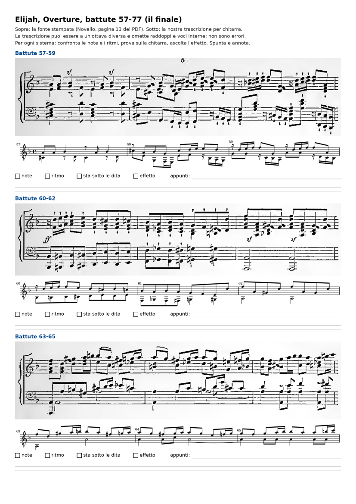
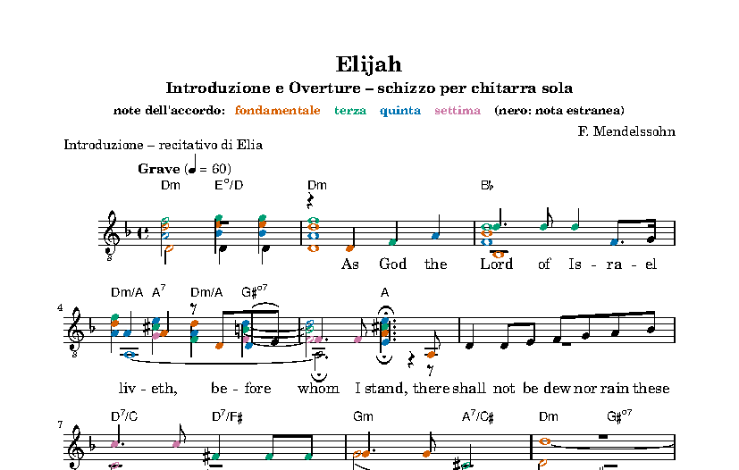
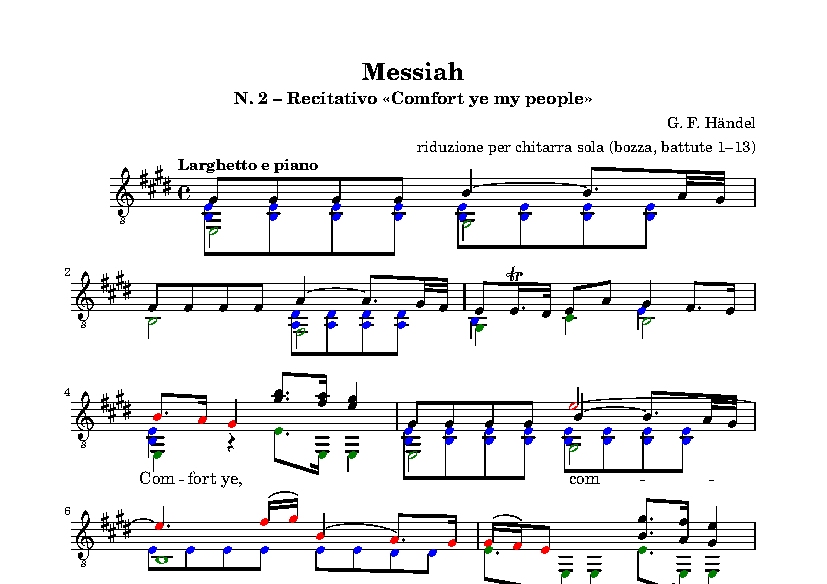

# Trascrizioni per chitarra classica con LilyPond e un assistente AI

**Benvenuto a chiunque voglia contribuire**: chitarristi che provano una pagina e
dicono cosa non funziona, chi sa leggere una fonte meglio di noi, chi conosce
LilyPond. Vedi [Come contribuire](#come-contribuire).

> **Stato del lavoro: tutto da verificare.** Per ora non c'è ancora stato il
> tempo di controllare sullo strumento e sulle fonti le trascrizioni create
> dall'AI, né di trascrivere per intero il manoscritto originale del maestro
> M. Vercesi (ne sono incise solo alcune parti). Le partiture qui sotto sono
> quindi **bozze di lavoro**, non edizioni da cui studiare o suonare in pubblico.

## Perché questo repository

Per incidere musica esistono soprattutto programmi proprietari, spesso a un
costo proibitivo, e senza una vera alternativa. Il manoscritto resta l'opzione
migliore, ma molti vogliono anche una versione incisa, e l'incisione è un'arte
difficile da padroneggiare. [LilyPond](https://lilypond.org) è un'alternativa
valida e libera: il risultato è bello, ma il linguaggio è contorto e lungo da
imparare. Qui l'AI ci aiuta a scriverlo; **il suo lavoro va comunque
controllato**, nota per nota, sulla fonte e sullo strumento.

Il bello è che con git e LilyPond tutto è testo: ogni scelta può essere
tracciata, abbandonata, ripresa, anche da altri, come si fa con il software
open source.

## Ringraziamento

Nulla di tutto questo sarebbe stato possibile senza il **maestro M. Vercesi**,
che con molta pazienza ha guidato la trascrizione e ha condiviso il metodo, la
tecnica, le scelte, il buon gusto, il rispetto del comportamento delle voci e i
compromessi a cui obbliga la chitarra stessa.

## Ultimi lavori

Il più recente in alto. **Ogni passo di lavoro aggiunge qui una voce**: che cosa
è cambiato, perché, e che cosa resta non verificato. Vale per tutti, assistente
AI compreso (vedi [Come contribuire](#come-contribuire)). Le voci più vecchie
scendono in [docs/diario.md](docs/diario.md). L'ultima voce ha una tabellina
con i file toccati: sorgente, strumenti usati, PDF generato.

<!-- DIARIO:inizio -->
- **2026-11-27 · README: perché l'RV 93 è difficile.** Corretta la
  spiegazione: le voci si pestano i piedi (anche sul rigo) e il nodo sono i
  bassi veloci con il pollice, non l'estensione. *Solo testo.*
- **2026-11-27 · README: il tempo, il sacrificio e la fermata.** Scritto il
  principio che guida le riduzioni: tempo più lento (soprattutto RV 93, primo
  movimento, e Overture dell'Elijah), note sacrificate, un effetto al posto
  delle voci ammucchiate; l'RV 93 è tra i più difficili da rendere completo.
  *Un principio: tempi e partiture non sono ancora stati cambiati.*
- **2026-11-27 · README: buone pratiche da studiare.** Aggiunta la sezione
  «Da fare: imparare da chi l'ha già fatto»: confrontare i nostri sorgenti con
  i manuali di LilyPond, openLilyLib, Mutopia e le edizioni di manoscritti, e
  ricavarne regole per noi e per i modelli. *Solo un proposito: niente è
  ancora stato studiato né cambiato.*
- **2026-11-27 · Vivaldi RV 93, primo movimento rifatto dall'autografo.**
  51 battute, quattro parti (liuto, violino I e II, basso), **lette**
  dall'autografo da un lettore che non ha visto altre edizioni. **Il controllo
  di un secondo lettore è in corso: per ora niente è da dare per buono.**
  Battute meno sicure: 35, 38, 46 (liuto), 42–43, 51 (basso), 26 (violino II);
  nelle 8–9 e 45 un do senza alterazione è scritto alla lettera come do♯ ma
  probabilmente è naturale. La versione per chitarra mette tutte le voci su un
  rigo (ottava sotto, basso compresso sopra il mi, ♩ = 76 scelto da noi) e
  **non è ancora chitarristica**; ogni voce è un layer che si può togliere.

  | Che cosa | Dove |
  |---|---|
  | Sorgente, note | [`brani/vivaldi-rv93/music/primo-movimento.ly`](brani/vivaldi-rv93/music/primo-movimento.ly) |
  | Sorgente, voci sul rigo | [`brani/vivaldi-rv93/layers/chitarra.ly`](brani/vivaldi-rv93/layers/chitarra.ly) |
  | Lettura grezza | [`brani/vivaldi-rv93/fonti/lettura-primo-movimento.txt`](brani/vivaldi-rv93/fonti/lettura-primo-movimento.txt) |
  | PDF | [chitarra](pdf/vivaldi-rv93/rv93-primo-chitarra.pdf) · [voci colorate](pdf/vivaldi-rv93/rv93-primo-chitarra-voci.pdf) · [solo liuto e basso](pdf/vivaldi-rv93/rv93-primo-liuto-basso.pdf) · [quattro parti](pdf/vivaldi-rv93/rv93-primo-partitura.pdf) |
  | Fonte | [autografo](brani/vivaldi-rv93/fonti/autografo-torino-IMSLP779675.pdf), pagine 1–4 |
- **2026-11-27 · Avviso sullo stato.** In testa al README è ora scritto che le
  trascrizioni create dall'AI non sono ancora state verificate e che il
  manoscritto del maestro M. Vercesi è trascritto solo in parte. *Nessuna nota
  è cambiata.*
- **2026-11-27 · Ringraziamento.** Aggiunto in testa al README il
  ringraziamento al maestro M. Vercesi. *Nessuna nota è cambiata.*
- **2026-11-27 · Elijah, finale: voci interne e accordi (battute 57–77).**
  Aggiunta la voce interna in 19 battute su 21 e gli accordi (sigle, gradi,
  colori) di tutte e 21. **Letti** sulla riduzione Novello da un lettore
  separato, con griglia delle altezze; **non ancora controllati da un secondo
  lettore**. La voce interna è un'ottava sotto, come il canto; nella 63 e in
  metà della 64 è il tenore del rigo di basso; 68–70 alleggerite (senza le
  semicrome parallele a tre voci); 74–75 vuote (andrebbe sotto il mi basso).
  Il controllo automatico dice solo che le note stanno sotto le dita a coppie
  e a tre: **non dice se le terze in semicrome di 73 e 76 si suonano a tempo**
  (da provare sullo strumento). Battuta 71: la Novello ha sol♯ (confermato dal
  lettore), la Peters sol naturale: resta una differenza tra edizioni.
- **2026-11-27 · README.** Aggiunta in testa la motivazione del progetto; la
  tabella dei PDF ora va dalla più recente alla più vecchia; l'ultima voce di
  questo diario porta una tabellina con sorgente, strumenti e PDF.
- **2026-11-27 · Nomi.** In tutti i file il trascrittore è ora citato come
  «maestro M. Vercesi», senza riferimenti personali; la stessa regola è
  applicata dall'esportatore della chat (`strumenti/esporta_chat.py`) e alla
  **storia di git** (file e messaggi dei commit riscritti). La foto del
  manoscritto resta nel repository. *Nessuna nota è cambiata.*
<!-- DIARIO:fine -->

## Le partiture, da scaricare

Tutti i PDF prodotti finora, in ordine cronologico. Sono **bozze di lavoro**, non
edizioni: leggi [lo stato di ogni brano](#i-brani-in-corso) prima di fidarti di una nota.

<!-- TABELLA-PDF:inizio -->
| Data | Brano | PDF | Caratteristiche | Per rigenerarlo |
|---|---|---|---|---|
| 2026-11-27 | Vivaldi, Concerto RV 93 | [rv93-primo-chitarra](pdf/vivaldi-rv93/rv93-primo-chitarra.pdf) | Primo movimento, chitarra sola: tutte le voci dell'autografo su un rigo (non ancora chitarristico), tempo ridotto. | `make build/vivaldi-rv93/rv93-primo-chitarra.pdf` |
| 2026-11-27 | Vivaldi, Concerto RV 93 | [rv93-primo-chitarra-voci](pdf/vivaldi-rv93/rv93-primo-chitarra-voci.pdf) | Come sopra, con le voci colorate: liuto rosso, violino I arancio, violino II blu, basso verde. | `make build/vivaldi-rv93/rv93-primo-chitarra-voci.pdf` |
| 2026-11-27 | Vivaldi, Concerto RV 93 | [rv93-primo-liuto-basso](pdf/vivaldi-rv93/rv93-primo-liuto-basso.pdf) | Primo movimento, chitarra sola: solo liuto e basso (tolti i layer dei violini). | `make build/vivaldi-rv93/rv93-primo-liuto-basso.pdf` |
| 2026-11-27 | Vivaldi, Concerto RV 93 | [rv93-primo-partitura](pdf/vivaldi-rv93/rv93-primo-partitura.pdf) | Primo movimento: le quattro parti come lette dall'autografo, per il confronto con la fonte. | `make build/vivaldi-rv93/rv93-primo-partitura.pdf` |
| 2026-11-20 | Mendelssohn, Elijah | [elijah](pdf/mendelssohn-elijah/elijah.pdf) | Introduzione e Overture, notazione classica. | `make build/mendelssohn-elijah/elijah.pdf` |
| 2026-11-20 | Mendelssohn, Elijah | [elijah-accordi](pdf/mendelssohn-elijah/elijah-accordi.pdf) | Sigle in stile jazz sopra il rigo e note strutturali dell'accordo colorate. Gli accordi sono dedotti dalle voci trascritte (vedi armonia/accordi.ly). | `make build/mendelssohn-elijah/elijah-accordi.pdf` |
| 2026-11-20 | Mendelssohn, Elijah | [elijah-sigle](pdf/mendelssohn-elijah/elijah-sigle.pdf) | Solo le sigle in stile jazz sopra il rigo, note in nero. | `make build/mendelssohn-elijah/elijah-sigle.pdf` |
| 2026-11-20 | Mendelssohn, Elijah | [elijah-tab](pdf/mendelssohn-elijah/elijah-tab.pdf) | Come sopra, con intavolatura. | `make build/mendelssohn-elijah/elijah-tab.pdf` |
| 2026-11-20 | Mendelssohn, Elijah | [elijah-voci](pdf/mendelssohn-elijah/elijah-voci.pdf) | Come sopra, con le voci in colori diversi (la voce di Elia in rosso). | `make build/mendelssohn-elijah/elijah-voci.pdf` |
| 2026-11-19 | Smetana, Vltava (La Moldava) | [moldava-due-voci](pdf/smetana-moldava/moldava-due-voci.pdf) | Come moldava-voci, con la seconda voce dell'introduzione: i clarinetti (battute 17-27) e la sesta inferiore dei flauti (28-35), in viola. Per studiare la partitura o per due chitarre: su una sola e' al limite. | `make build/smetana-moldava/moldava-due-voci.pdf` |
| 2026-11-19 | Smetana, Vltava (La Moldava) | [moldava-onda](pdf/smetana-moldava/moldava-onda.pdf) | Il tema con l'onda di semicrome sotto, al posto degli accordi. | `make build/smetana-moldava/moldava-onda.pdf` |
| 2026-11-18 | Händel, Messiah, «Comfort ye» | [comfort-ye-chitarra](pdf/messiah-comfort-ye/comfort-ye-chitarra.pdf) | Chitarra sola, con il testo sotto il canto. | `make build/messiah-comfort-ye/comfort-ye-chitarra.pdf` |
| 2026-11-18 | Händel, Messiah, «Comfort ye» | [comfort-ye-chitarra-accordi](pdf/messiah-comfort-ye/comfort-ye-chitarra-accordi.pdf) | Con sigle e note strutturali dell'accordo colorate. | `make build/messiah-comfort-ye/comfort-ye-chitarra-accordi.pdf` |
| 2026-11-18 | Händel, Messiah, «Comfort ye» | [comfort-ye-chitarra-tab](pdf/messiah-comfort-ye/comfort-ye-chitarra-tab.pdf) | Con intavolatura. | `make build/messiah-comfort-ye/comfort-ye-chitarra-tab.pdf` |
| 2026-11-18 | Händel, Messiah, «Comfort ye» | [comfort-ye-chitarra-voci](pdf/messiah-comfort-ye/comfort-ye-chitarra-voci.pdf) | Come sopra, con le quattro voci in colori diversi (canto in rosso). | `make build/messiah-comfort-ye/comfort-ye-chitarra-voci.pdf` |
| 2026-11-18 | Händel, Messiah, Overture | [allegro-bozza](pdf/messiah-overture/allegro-bozza.pdf) | Bozza di lavoro dell'Allegro: numero su ogni battuta, contato dall'inizio dell'Allegro come nel manoscritto. | `make build/messiah-overture/allegro-bozza.pdf` |
| 2026-11-18 | Händel, Messiah, Overture | [allegro-finale-bozza](pdf/messiah-overture/allegro-finale-bozza.pdf) | Bozza di lavoro: ultime 11 battute dell'Allegro, dal manoscritto. Un numero su ogni battuta, per il confronto. | `make build/messiah-overture/allegro-finale-bozza.pdf` |
| 2026-11-18 | Händel, Messiah, Overture | [allegro-shorts](pdf/messiah-overture/allegro-shorts.pdf) | Video verticali: due sistemi per pagina, voci colorate, intavolatura. | `make build/messiah-overture/allegro-shorts.pdf` |
| 2026-11-18 | Händel, Messiah, Overture | [allegro-voci-separate](pdf/messiah-overture/allegro-voci-separate.pdf) | Le quattro parti d'arco su righi separati (per studiare le voci). | `make build/messiah-overture/allegro-voci-separate.pdf` |
| 2026-11-18 | Händel, Messiah, Overture | [overture-ariosa](pdf/messiah-overture/overture-ariosa.pdf) | Note grandi e larghe, per lo studio e la prima vista. | `make build/messiah-overture/overture-ariosa.pdf` |
| 2026-11-18 | Händel, Messiah, Overture | [overture-classica](pdf/messiah-overture/overture-classica.pdf) | Edizione di riferimento: sola notazione con diteggiature, impaginazione da leggio. | `make build/messiah-overture/overture-classica.pdf` |
| 2026-11-18 | Händel, Messiah, Overture | [overture-classica-accordi](pdf/messiah-overture/overture-classica-accordi.pdf) | Sigle jazz sopra il rigo e note strutturali dell'accordo colorate. | `make build/messiah-overture/overture-classica-accordi.pdf` |
| 2026-11-18 | Händel, Messiah, Overture | [overture-classica-armonia](pdf/messiah-overture/overture-classica-armonia.pdf) | Come overture-classica, con le tre scritture dell'armonia: sigle jazz sopra il rigo, gradi e funzioni (in grassetto) sotto. | `make build/messiah-overture/overture-classica-armonia.pdf` |
| 2026-11-18 | Händel, Messiah, Overture | [overture-classica-armonia-la-minore](pdf/messiah-overture/overture-classica-armonia-la-minore.pdf) | La stessa Overture trasportata in la minore: le note cambiano, l'armonia scritta sotto resta identica. Senza diteggiature. | `make build/messiah-overture/overture-classica-armonia-la-minore.pdf` |
| 2026-11-18 | Händel, Messiah, Overture | [overture-classica-colori](pdf/messiah-overture/overture-classica-colori.pdf) | Come overture-classica, una voce per colore. | `make build/messiah-overture/overture-classica-colori.pdf` |
| 2026-11-18 | Händel, Messiah, Overture | [overture-classica-doppio-rigo](pdf/messiah-overture/overture-classica-doppio-rigo.pdf) | Doppio rigo (violino + basso) ad altezze reali. | `make build/messiah-overture/overture-classica-doppio-rigo.pdf` |
| 2026-11-18 | Händel, Messiah, Overture | [overture-classica-provenienza](pdf/messiah-overture/overture-classica-provenienza.pdf) | Colora le note che vengono dalle edizioni di riferimento. | `make build/messiah-overture/overture-classica-provenienza.pdf` |
| 2026-11-18 | Händel, Messiah, Overture | [overture-classica-senza-dita](pdf/messiah-overture/overture-classica-senza-dita.pdf) | Come overture-classica, senza diteggiature, corde e barre'. | `make build/messiah-overture/overture-classica-senza-dita.pdf` |
| 2026-11-18 | Händel, Messiah, Overture | [overture-classica-tab](pdf/messiah-overture/overture-classica-tab.pdf) | Come overture-classica, con il rigo di intavolatura. | `make build/messiah-overture/overture-classica-tab.pdf` |
| 2026-11-18 | Händel, Messiah, Overture | [overture-compatta](pdf/messiah-overture/overture-compatta.pdf) | Tutto in una pagina, spaziatura stretta. | `make build/messiah-overture/overture-compatta.pdf` |
| 2026-11-18 | Händel, Messiah, Overture | [overture-telefono](pdf/messiah-overture/overture-telefono.pdf) | Schermo del cellulare, voci colorate. | `make build/messiah-overture/overture-telefono.pdf` |
| 2026-11-18 | Smetana, Vltava (La Moldava) | [moldava](pdf/smetana-moldava/moldava.pdf) | Notazione classica. | `make build/smetana-moldava/moldava.pdf` |
| 2026-11-18 | Smetana, Vltava (La Moldava) | [moldava-accordi](pdf/smetana-moldava/moldava-accordi.pdf) | Sigle e note strutturali dell'accordo colorate. | `make build/smetana-moldava/moldava-accordi.pdf` |
| 2026-11-18 | Smetana, Vltava (La Moldava) | [moldava-voci](pdf/smetana-moldava/moldava-voci.pdf) | Le tre voci in colori diversi: canto rosso, onda e accordi blu, bassi e armonici verdi. | `make build/smetana-moldava/moldava-voci.pdf` |
<!-- TABELLA-PDF:fine -->

### Come rigenerarle

Servono [LilyPond](https://lilypond.org) 2.24 e `make`.

    make                               # tutte le edizioni, in build/<brano>/
    make BRANO=mendelssohn-elijah      # un solo brano
    make build/smetana-moldava/moldava.pdf    # una sola edizione
    make pubblica                      # ricompila, copia in pdf/ e aggiorna questa tabella

### Quali file modificare

Ogni brano è una cartella `brani/<brano>/`, divisa in strati indipendenti:

| Voglio cambiare… | File da modificare |
|---|---|
| una nota, un ritmo, una pausa | `brani/<brano>/music/*.ly`: una variabile per voce, una battuta per riga, preceduta dal suo numero (`%12`) e chiusa dal controllo di battuta |
| una diteggiatura, una corda, un barré | `brani/<brano>/dita/*.ly`: stesso ritmo delle note, scritto a spazi (`s4-3` = dito 3 sulla nota di quel quarto) |
| un accordo in sigla, un grado, una funzione | `brani/<brano>/armonia/*.ly` |
| quali voci stanno sul rigo, i colori, le dinamiche | `brani/<brano>/layers/*.ly` |
| il formato della pagina, la densità | `impaginazioni/*.ly` (comuni a tutti i brani) |
| che cosa stampa un PDF (impaginazione + opzioni) | `brani/<brano>/editions/<nome>.ly`: poche righe; copiarne una per fare una nuova edizione |
| una funzione o un'opzione comune | `lib/*.ly` (le opzioni sono elencate in `lib/opzioni.ly`) |

Le note sono in italiano (`do re mi`, `dod` = do diesis, `sib` = si bemolle;
`'` e `,` spostano l'ottava). Dopo ogni modifica si lancia `make`: se una battuta
non torna, LilyPond dice la riga. Dettagli in [brani/README.md](brani/README.md)
e più sotto in [Come si compila](#come-si-compila).

### Come contribuire

- **Suonare e riferire.** È il contributo più utile: apri un PDF, prova un
  passaggio, e scrivi in una *issue* la battuta e cosa non va (nota sbagliata,
  non sta sotto le dita, non rende l'effetto). Non serve conoscere LilyPond.
- **Rivedere con la scheda.** In [docs/revisione/](docs/revisione/) ci sono
  schede con la fonte sopra e la trascrizione sotto: si stampano, si spuntano,
  si fotografano.
- **Correggere i sorgenti.** Una battuta per riga: una *pull request* con la
  riga corretta e la fonte da cui viene è benvenuta.
- **Proporre un'altra soluzione.** Diteggiature e scelte di riduzione sono
  strati separati: si può aggiungere la propria senza cancellare quella che c'è.
- **Proporre un brano** di pubblico dominio, con la fonte.

**Tre regole per ogni contributo**, di una persona o di un assistente AI:

1. **Aggiorna [Ultimi lavori](#ultimi-lavori)** in testa a questo file con una
   voce datata: che cosa hai cambiato, perché, e che cosa non hai verificato.
   Deve bastare quella voce per capire l'ultimo lavoro fatto.
2. Di' se ogni nota è *letta* (da quale fonte), *dedotta* o *non verificata*.
3. Usa solo fonti di pubblico dominio o con licenza compatibile, e citale.

Se hai rigenerato i PDF, lancia `make pubblica` così la tabella resta allineata.

---

Un laboratorio: ridurre per **chitarra sola** musica nata per orchestra, coro o
ensemble (Händel, Mendelssohn, Vivaldi, Smetana), scrivendo le partiture in
LilyPond con l'aiuto di un assistente AI, e capire **quanto di questo lavoro si
può davvero affidare all'AI** e quanto va riletto, corretto e ascoltato da un
chitarrista.

È un cantiere aperto. Quasi tutto quello che c'è qui è una **bozza da
verificare**, non un'edizione.

## Il processo che stiamo seguendo

1. **Fonte.** Si parte da edizioni di pubblico dominio (IMSLP) o dal manoscritto;
   i PDF stanno in `brani/<brano>/fonti/`.
2. **Lettura.** L'AI legge la scansione battuta per battuta, con una griglia dei
   nomi delle note sovrapposta al rigo, e scrive le note in LilyPond.
3. **Strati.** Note, diteggiature, armonia, impaginazione stanno in file
   separati, così ogni scelta si può cambiare senza toccare le altre.
4. **Verifica avversariale.** Un secondo lettore, che non ha visto il lavoro del
   primo, confronta la trascrizione con la stampa partendo dal presupposto che
   sia sbagliata: prima i ritmi, poi le altezze. Dove esistono due edizioni si
   incrociano.
5. **Controllo automatico.** Uno script verifica che il basso stia sotto il
   canto e che le note stiano sotto le dita.
6. **Revisione umana.** Si stampa una *scheda di revisione* (fonte sopra,
   trascrizione sotto), si suona, si ascolta, si annota. È il passo che decide.

La scheda si genera con `strumenti/scheda_revisione.py`; un esempio completo è
[docs/revisione/elijah-overture-57-77.pdf](docs/revisione/elijah-overture-57-77.pdf).

## I tre criteri (e dove l'AI aiuta davvero)

Ogni battuta va giudicata tre volte, e sono tre giudizi diversi:

| Criterio | Domanda | Che cosa può fare l'AI | Che cosa resta al chitarrista |
|---|---|---|---|
| **Concordanza** con l'originale | Le note e i ritmi sono quelli della fonte? | Leggere, confrontare, far controllare da un secondo lettore. Funziona, ma sbaglia: vedi sotto. | Decidere i casi dubbi, soprattutto dove le edizioni non coincidono. |
| **Idiomaticità** ("chitarrabilità") | Sta sotto le dita? Suona naturale sullo strumento? | Controlli meccanici: estensione, apertura della mano, incroci delle voci. | Tutto il resto: diteggiatura, posizione, fatica, velocità. Si capisce solo suonando. |
| **Effetto** | Dà l'illusione dell'originale? | Proporre soluzioni (ottave, armonici, arpeggi al posto di accordi tenuti, dinamiche per voce). | Giudicare all'ascolto, e avere il coraggio di cambiare le note, come fa Villa-Lobos, quando l'effetto lo chiede. |

Per "chitarrabilità" il termine in uso è **idiomaticità**: una scrittura è
*idiomatica* quando sfrutta ciò che lo strumento fa bene (corde a vuoto,
posizioni fisse, armonici, campanelas). *Suonabilità* indica solo il livello
minimo: che il passo si possa eseguire.

### Perplessità, dichiarate

- **L'AI legge male più spesso di quanto sembri.** Nell'Overture di Elijah i
  controlli indipendenti hanno trovato 14 errori in battute già date per
  buone: ritmi invertiti, alterazioni mancanti, una nota legata che era
  ribattuta, accordi sbagliati. Senza il secondo lettore sarebbero rimasti.
- **L'AI non sente e non suona.** Tutto ciò che riguarda idiomaticità ed effetto
  è scritto "a tavolino": plausibile, mai provato. Tre errori li ha trovati
  l'orecchio del chitarrista prima dei controlli.
- **L'AI dichiara le incertezze, ma non sempre.** Più volte una lettura
  "dedotta" si è rivelata sbagliata. Regola adottata: ogni nota è *letta*,
  *dedotta* o *non verificata*, e va scritto quale.
- **Il costo della verifica è alto.** Controllare richiede più lavoro che
  scrivere. Resta da capire se, sommando tutto, si risparmia tempo rispetto a
  trascrivere a mano, o se il vantaggio è un altro: poter generare dalla stessa
  musica versioni, livelli e materiali di studio diversi.
- **Quanta libertà?** Una riduzione fedele nota per nota spesso non è
  chitarristica. Dove finisce la trascrizione e dove comincia una nuova
  scrittura è una decisione musicale, non tecnica.

## Il tempo, il sacrificio e la fermata

Godere delle note della chitarra richiede suonare, fermarsi, ascoltare e
contemplare ogni onda che un suono propaga. La «fermata» musicale, sulla
chitarra classica, è quasi il comportamento normale, e un obbligo: una
riduzione che non lascia il tempo di ascoltare non funziona, per quanto sia
fedele.

Ne seguono tre scelte, da tenere presenti in ogni brano:

- **abbassare il tempo**, anche di molto. Vale soprattutto per il primo
  movimento dell'RV 93 e per l'Overture dell'Elijah;
- **sacrificare note**: non tutto quello che è nella partitura può stare sotto
  le dita, e non tutto serve a far sentire l'orchestra;
- **cercare un effetto** che suggerisca quello che non si può suonare, invece
  di ammucchiare voci.

Il Concerto RV 93, paradossalmente, è uno dei più difficili da rendere
completo sulla chitarra. Non è questione di estensione: le voci si pestano i
piedi, anche visivamente sul rigo. Il nodo è la manualità, soprattutto i bassi
veloci da fare con il pollice, molto difficili mentre le altre dita portano il
resto. La versione «tutte le voci su un rigo» serve a vedere che cosa c'è, non
a essere suonata così.

## Da fare: imparare da chi l'ha già fatto

La struttura di questi sorgenti (note, diteggiature, armonia, impaginazioni ed
edizioni in file separati) è nata strada facendo. **Non è ancora stata
confrontata con le buone pratiche** di chi pubblica con LilyPond da anni, e va
fatto, per due scopi: rendere i sorgenti più manutenibili, componibili e a
strati, in modo che ognuno incida la versione che vuole; e dare ai modelli
esempi e regole da cui imparare gli schemi giusti, invece di reinventarli.

Da dove partire (elenco da verificare e completare, non ancora studiato):

- i manuali di LilyPond: *Learning Manual* e *Notation Reference*, in
  particolare i consigli su come organizzare i file, le variabili, i `\tag` e
  le parti estratte da una stessa musica;
- [openLilyLib](https://github.com/openlilylib) e il suo *edition-engraver*,
  che applica correzioni e ritocchi a una partitura senza toccare le note: è
  la stessa idea dei nostri layer, fatta da chi la usa per edizioni vere;
- i sorgenti pubblicati su [Mutopia](https://www.mutopiaproject.org) e i
  progetti di edizione che tengono la musica sotto git, per vedere come
  nominano le voci, dividono i file e segnano le fonti;
- le edizioni di manoscritti (segni editoriali, note critiche, che cosa è
  letto e che cosa è congettura), per dare una forma a quello che qui
  scriviamo nei commenti.

Il risultato atteso è un documento di regole (`docs/`), da applicare ai brani
esistenti e da far leggere all'assistente prima di ogni lavoro.

## I brani in corso

| Brano | Stato | Da risolvere |
|---|---|---|
| **Händel, Messiah, Overture** (`messiah-overture`), trascrizione di M. Vercesi | Grave in bozza; Allegro battute 1–38 e le ultime 11 dal manoscritto | Mancano le battute 39–74 dell'Allegro; confronto col manoscritto; diteggiature del maestro M. Vercesi |
| **Händel, Messiah n. 2, «Comfort ye»** (`messiah-comfort-ye`) | Battute 1–13 | Battute 14–37 |
| **Mendelssohn, Elijah, Introduzione e Overture** (`mendelssohn-elijah`) | Recitativo completo; Overture intera, 77 battute; ritmi e altezze verificati; fine confrontata su due edizioni | Voci interne dalla battuta 39; battuta 71 (sol o sol♯: le edizioni non coincidono); mai provata sullo strumento |
| **Vivaldi, Concerto RV 93** (`vivaldi-rv93`) | Primo movimento (51 battute) riletto dall'autografo, tutte le voci su un rigo; la prima versione, da un arrangiamento moderno, è stata tolta | Controllo del secondo lettore; renderlo chitarristico; Largo e terzo movimento |
| **Smetana, Vltava** (`smetana-moldava`) | Esperimento: 74 battute, i flauti dell'introduzione in una sola linea, tema sulla quarta corda | In pausa: revisione dell'effetto da parte del chitarrista |

### Come appaiono oggi

**Messiah, Overture**: in nero ciò che viene dalla trascrizione, in viola le
bozze prese dalle edizioni di riferimento.

**Elijah**: il recitativo con la voce (rosso), gli accordi degli ottoni (blu) e
il basso (verde), poi l'inizio della fuga.

Lo stesso con le sigle degli accordi e le note strutturali colorate
(fondamentale, terza, quinta, settima):

**La Moldava**: l'introduzione dei due flauti e il tema, alla maniera del
Preludio n. 1 di Villa-Lobos.

**«Comfort ye»**: il canto col testo, da cantare o da suonare.

## Dove leggere il resto

- [IDEE.md](IDEE.md): idee, piano di lavoro, cose da decidere, stato di ogni brano.
- [docs/cronologia-chat.md](docs/cronologia-chat.md): la conversazione con
  l'assistente, per risalire alle scelte (istantanea, solo testo).
- [brani/README.md](brani/README.md): come è fatta la cartella di un brano.

## Come si compila

    make                                                # tutte le edizioni di tutti i brani, in build/<brano>/
    make BRANO=messiah-overture                         # un solo brano
    make build/messiah-overture/overture-classica.pdf   # una sola edizione
    make stampa BRANO=messiah-overture IMPAGINAZIONE=ariosa DITA=nessuna TAB=si COLORI=si   # combinazione a scelta

Ogni brano ha la sua cartella in `brani/`; funzioni e impaginazioni sono in
comune. La musica è divisa in strati indipendenti:

| Cartella                   | Contenuto                                                      |
|----------------------------|----------------------------------------------------------------|
| `brani/<brano>/music/`     | solo note e durate, una variabile per voce, una battuta per riga |
| `brani/<brano>/dita/`      | diteggiature, corde e barré: un file per diteggiatura          |
| `brani/<brano>/armonia/`   | l'armonia battuta per battuta: accordi, gradi e funzioni       |
| `brani/<brano>/layers/`    | assemblaggio delle voci, dinamiche, provenienza, ritocchi      |
| `brani/<brano>/editions/`  | ricette: impaginazione + diteggiatura + opzioni + partitura    |
| `brani/<brano>/fonti/`     | foto del manoscritto e altre fonti                             |
| `brani/<brano>/brano.ly`   | l'unico file che un'edizione include per avere tutto il brano  |
| `impaginazioni/`           | formato pagina, grandezza e densità delle note (comuni)        |
| `lib/`                     | funzioni e opzioni comuni a tutti i brani                      |

Brani:

- `messiah-overture`: Händel, Overture del Messiah, trascrizione di M. Vercesi.
- `messiah-comfort-ye`: Händel, Messiah n. 2, recitativo «Comfort ye my people», riduzione per chitarra sola (battute 1–13, in bozza).
- `mendelssohn-elijah`: Mendelssohn, Elijah: il recitativo iniziale con un basso e l'Overture intera (77 battute), schizzo per chitarra sola.
- `smetana-moldava`: Smetana, Vltava: esperimento per chitarra sola (74 battute): i due flauti intrecciati dell'introduzione e il tema alla maniera di Villa-Lobos.
- `vivaldi-rv93`: Vivaldi, Concerto in re maggiore RV 93: primo movimento dall'autografo (da controllare).

| Impaginazione | Aspetto                                                              |
|---------------|----------------------------------------------------------------------|
| `classica`    | A4 da leggio, circa quattro battute per rigo, margini ampi           |
| `ariosa`      | A4, note grandi e larghe, per lo studio e la prima vista             |
| `compatta`    | A4, spaziatura stretta: tutto in una pagina                          |
| `telefono`    | pagina stretta e alta per lo schermo del cellulare                   |
| `shorts`      | A6 per video verticali, due sistemi per pagina                       |

| Edizione                        | Cosa stampa                                              |
|---------------------------------|----------------------------------------------------------|
| `overture-classica`             | Grave + Allegro, sola notazione con diteggiature         |
| `overture-classica-tab`         | come sopra, con il rigo di intavolatura                  |
| `overture-classica-colori`      | come sopra, una voce per colore                          |
| `overture-classica-senza-dita`  | senza diteggiature, corde e barré                        |
| `overture-classica-doppio-rigo` | doppio rigo (violino + basso) ad altezze reali           |
| `overture-classica-armonia`     | sigle jazz sopra, gradi e funzioni sotto il rigo         |
| `overture-classica-accordi`     | sigle jazz e note strutturali dell'accordo colorate      |
| `overture-classica-provenienza` | in colore le note prese dalle edizioni di riferimento    |
| `overture-classica-armonia-la-minore` | la stessa, trasportata in la minore                |
| `overture-ariosa`               | note grandi e larghe                                     |
| `overture-compatta`             | tutto in una pagina                                      |
| `overture-telefono`             | per il cellulare, voci colorate                          |
| `allegro-voci-separate`         | le quattro parti d'arco dell'Allegro su righi separati   |
| `allegro-bozza`                 | l'Allegro da solo, con il numero su ogni battuta         |
| `allegro-finale-bozza`          | ultime 11 battute dell'Allegro, dal manoscritto (bozza)  |
| `allegro-shorts`                | video verticali, voci colorate, intavolatura             |

Le opzioni di un'edizione (`intavolatura`, `coloriVoci`, `sigle`, ...) sono
elencate in `lib/opzioni.ly`. Per aggiungere un brano: vedi
[brani/README.md](brani/README.md).

## Crediti e fonti

Vedi anche il [ringraziamento](#ringraziamento) in testa.

La trascrizione per chitarra è di **M. Vercesi**; questo repository la
incide con LilyPond a partire dal suo manoscritto. Dove il manoscritto non
è ancora stato letto, le battute sono bozze segnate come tali nei file di
`music/`.

Per le note di Händel (dominio pubblico) si confrontano:

- l'edizione di riferimento: la riduzione per pianoforte di T. Tertius Noble
  e Max Spicker, G. Schirmer 1912 (dominio pubblico, IMSLP #11870);
- la partitura orchestrale in LilyPond delle Éditions Nicolas Sceaux
  (<https://github.com/nsceaux/nenuvar>, CC BY-SA 4.0), usata solo per
  confronto: nessun suo file è copiato in questo repository.

## La prima versione (2023)

Le immagini della prima incisione dell'Overture del Messiah, prima di questo lavoro:

[TheMessiah.pdf](https://github.com/montoyaedu/TheMessiah/files/11205354/TheMessiah.pdf)
